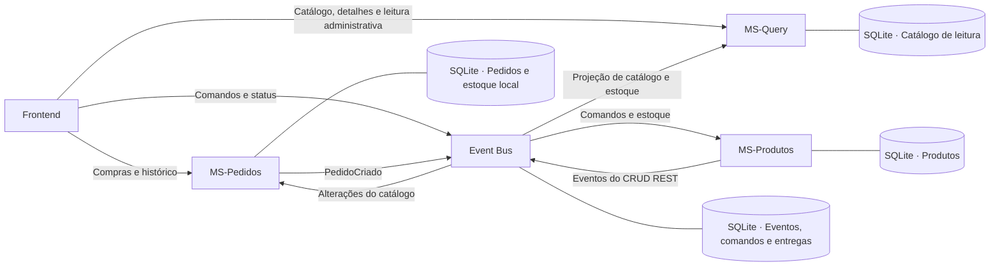

# 📚 BooksTop

BooksTop é uma livraria virtual desenvolvida para a disciplina de Desenvolvimento Web 3. O projeto reúne catálogo, gerenciamento de livros e pedidos para demonstrar comunicação por eventos e tolerância a falhas.

## ✨ Sobre o projeto

A aplicação usa React no frontend e microserviços Node.js com Express no backend. Cada serviço mantém seu próprio banco SQLite. Se o MS-Produtos parar, o catálogo, as compras e o gerenciamento continuam disponíveis enquanto o MS-Query, o MS-Pedidos e o Event Bus estiverem ativos.

## 📖 Funcionalidades

- Catálogo com busca, paginação e página de detalhes.
- Minha Estante com favoritos mantidos no navegador.
- Sacola, realização de pedidos, controle de estoque e histórico de compras.
- Gerenciamento com cadastro, consulta, edição e exclusão, além de confirmação e mensagens na própria interface.
- Registro de alterações durante a indisponibilidade do MS-Produtos e sincronização automática quando ele volta.

## 🧩 Arquitetura



| Componente | Responsabilidade |
| --- | --- |
| Frontend | Interface da loja e do gerenciamento |
| MS-Produtos | Catálogo oficial e CRUD REST de livros |
| MS-Pedidos | Compras, histórico e estoque disponível para venda |
| MS-Query | Catálogo de leitura usado pelo frontend |
| Event Bus | Persistência e reenvio de comandos e eventos por consumidor |

### Como funciona

1. O MS-Query mantém uma cópia do catálogo para consultas. O MS-Pedidos usa sua cópia local para validar compras e descontar estoque.
2. O Event Bus registra os comandos do gerenciamento e entrega as alterações ao MS-Pedidos e ao MS-Query. O novo livro recebe o mesmo UUID em todos os serviços.
3. Quando o MS-Produtos volta, o Bus reenvia as entregas pendentes. O status muda de **Aguardando sincronização** para **Sincronizado** após a confirmação dos consumidores.
4. Cada pedido guarda o título, o preço e o total da compra. Edições e exclusões posteriores preservam esse histórico.

## 🛠️ Tecnologias

- **Frontend** · React, React Router, Vite, Axios e CSS.
- **Backend** · Node.js, Express, CORS e SQLite com `sql.js`.
- **Execução opcional em contêineres** · Docker Compose.

## ✅ Pré-requisitos

- Node.js 20.13 ou superior, com npm. Para uma instalação nova, prefira [Node.js 24 LTS](https://nodejs.org/en/about/previous-releases).
- Docker com Compose é opcional.

## ▶️ Como executar

Na raiz do projeto, instale as dependências uma vez e inicie os serviços.

```sh
npm install
npm run dev
```

Abra o [BooksTop](http://localhost:5173). Na primeira execução, os serviços criam suas bases e carregam o catálogo inicial. O catálogo pode levar alguns segundos para aparecer.

Os endereços locais funcionam com a configuração padrão. Para usar outros endereços das APIs, consulte o [exemplo de configuração do frontend](frontend/.env.example).

### Instalação individual dos serviços

A partir da raiz, execute a sequência abaixo. Ela funciona no PowerShell e em shells Unix. Cada serviço usa seu próprio lockfile nessa modalidade.

```sh
cd event-bus
npm install --workspaces=false
cd ../ms-produtos
npm install --workspaces=false
cd ../ms-pedidos
npm install --workspaces=false
cd ../ms-query
npm install --workspaces=false
cd ../frontend
npm install --workspaces=false
cd ..
npm run dev
```

## 🔌 Portas

| Serviço | Porta padrão |
| --- | ---: |
| Frontend | 5173 |
| MS-Produtos | 3001 |
| MS-Pedidos | 3002 |
| MS-Query | 3003 |
| Event Bus | 3004 |

## 🧪 Executando os serviços separadamente

Para a demonstração de resiliência, execute cada comando em um terminal separado, a partir da raiz. Deixe livres as portas da tabela.

```sh
npm run dev:event-bus
npm run dev:produtos
npm run dev:pedidos
npm run dev:query
npm run dev:frontend
```

## ✏️ Testando o CRUD

1. Abra [Gerenciar](http://localhost:5173/gerenciar) e clique em **Cadastrar novo livro**.
2. Preencha os campos obrigatórios e salve. Confira a mensagem de sucesso e localize o livro no [catálogo](http://localhost:5173/catalogo).
3. Volte a **Gerenciar**, edite o título ou o preço e confira a alteração no catálogo.
4. Exclua o livro que você cadastrou, confirme no modal e confira a remoção nas duas telas.

## 🛡️ Testando a resiliência

1. Com todos os serviços ativos, cadastre um livro de teste em **Gerenciar** e compre um exemplar pelo catálogo.
2. Pressione `Ctrl+C` somente no terminal do **MS-Produtos**. Recarregue o catálogo e abra os detalhes de um livro.
3. Cadastre um segundo livro de teste em **Gerenciar** e confira **Aguardando sincronização**. Edite o segundo livro, compre um exemplar e exclua o primeiro.
4. Religue Produtos com `npm run dev:produtos`. Aguarde a entrega ou use **Atualizar** em **Gerenciar** para ver **Sincronizado**.
5. Confira a remoção e o estoque no catálogo. Use **Atualizar catálogo** se a página tiver sido carregada antes de o evento da compra chegar. Os dois pedidos continuam no [histórico](http://localhost:5173/pedidos), com o preço de cada compra.

## 🐳 Docker

Com Docker Compose instalado, execute a partir da raiz.

```sh
docker compose up --build
```

Acesse o [BooksTop](http://localhost:5173). Em outro terminal, encerre os contêineres com `docker compose down`. Os volumes mantêm os dados entre as execuções.

## 📮 API e Postman

Importe a [coleção do BooksTop](docs/BooksTop.postman_collection.json). Ela inclui o CRUD do MS-Produtos, a criação e a consulta de pedidos, as consultas do MS-Query e os comandos administrativos do Event Bus. Na pasta **Admin / Event Bus**, o cadastro salva o UUID do livro. As operações salvam o ID do último comando para consultar sua entrega.

## Testes e build

```sh
npm test
npm run build
```

A suíte usa portas e bancos temporários. Ela cobre CRUD, pedidos, estoque, reenvios e recuperação depois de reiniciar o Event Bus.

## 📁 Estrutura

```text
BooksTop/
├── frontend/
├── event-bus/
├── ms-produtos/
├── ms-pedidos/
├── ms-query/
├── docs/
├── scripts/
├── docker-compose.yml
├── package.json
├── package-lock.json
└── README.md
```
